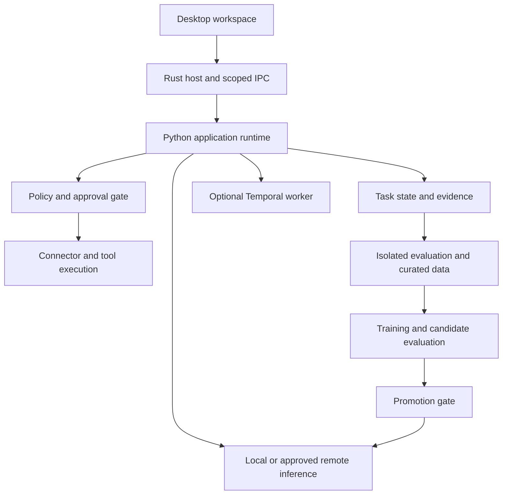

# Veya: project scope and delivery plan

Version 1.0. Prepared 20 October 2026. Veya is a short working name, not a claim of trademark or domain availability. This plan supersedes the original Relay Studio scope and its rough 300-430-hour estimate.

## Product objective

Build a Windows-first desktop AI employee that accepts an instruction, uses permitted business information and tools, performs a multi-step workflow, and returns completed work with evidence. Users should not have to drive every tool call. The system asks for missing information or approval when the workflow genuinely needs it.

The first useful job is invoice exception resolution. A user supplies invoices, purchase orders, receipt records and policies. Veya extracts the records, checks the numbers, investigates discrepancies, proposes a resolution, obtains required approval, writes one draft resolution to a fixture ERP, and verifies the final state. The first release never transfers money.

Behind that user experience is an engineering workspace for traces, reproducible environments, evaluation, dataset curation, post-training and controlled deployment. This is the depth relevant to the Ema role: owning the system from realistic task execution through a measured improvement loop.

The distinguishing research question is: for a particular workflow failure and resource budget, which intervention helps most: better retrieval, clarification, verification, tool recovery, reviewed memory, model escalation or post-training? This is a testable project hypothesis. It is not an assertion of a new algorithm or proprietary Ema implementation.

## Users and supported work

| User | Primary work | Successful outcome |
| --- | --- | --- |
| Operations user | Delegate a task, attach information, inspect progress and results | Useful completed output with evidence and clear unresolved exceptions |
| Reviewer | Inspect and approve exact proposed changes | The approved operation happens once within its authorized scope |
| Agent engineer | Reproduce a failure and compare interventions | A diagnosis backed by a repeatable environment and measured outcomes |
| ML researcher | Curate traces, train and evaluate a candidate | Reproducible evidence of improvement or a defensible negative result |
| Maintainer | Review contributions, operate services and release desktop builds | Traceable builds with real tests, recovery procedures and protected credentials |

## Goals and measures

| ID | Goal | Evidence required |
| --- | --- | --- |
| G1 | Delegate useful work from a native desktop | A real model completes the declared invoice workflow through UI, tools, approval and final-state verification |
| G2 | Preserve correctness through interruption | Fault tests cover crash, retry, cancellation, duplicate delivery and unknown external outcomes |
| G3 | Keep actions inside authority | Deterministic checks reject forbidden operations at the real execution boundary and retain an audit record |
| G4 | Measure behavior honestly | Held-out task families, repeated runs, complete denominators, calibrated judges and paired uncertainty |
| G5 | Complete a meaningful learning experiment | One SFT experiment plus a cheaper-intervention comparison with data lineage, latency and cost |
| G6 | Deliver maintainable, operable software | Reproducible builds, actual GitHub results, telemetry, native installation, upgrade and rollback evidence |
| G7 | Support extension and transfer | Additional workflow families and adapters pass shared contracts; optional work is separately budgeted |

Success is not source-line count or number of services. Zero unauthorized effects in a declared test suite is an acceptance condition for that suite, not a guarantee that every future attack is prevented. A completed research experiment may conclude that the proposed technique does not help.

## End-to-end invoice acceptance scenario

1. The user opens the installed desktop app and chooses a configured inference endpoint.
2. They submit: “Review these invoices, match them against orders and receipts, and prepare resolutions for approval.”
3. Veya validates and ingests the attachments, retaining page/cell evidence and document versions.
4. The agent calls typed tools to extract and compare records. Arithmetic and currency rules are deterministic.
5. For a fixture with 120 invoiced units and 100 received units at 12 per unit, the system identifies a 240 discrepancy.
6. It checks the applicable effective-dated policy. Missing receipts or contradictory evidence cause a specific clarification.
7. It presents the proposed draft action, exact arguments, evidence and policy reason.
8. An authorized reviewer approves that immutable proposal. The executor rechecks policy and approval immediately before the effect.
9. The fixture ERP receives one idempotent draft write. A timeout after commit is reconciled by operation identity before retry.
10. Veya verifies the resulting ERP state and returns the draft ID, reconciliation report, citations and unresolved exceptions.
11. A failed run can be restored into an isolated environment and replayed with one intervention changed.
12. Reviewed and permitted traces can become dataset rows. A candidate model must pass evaluation before activation.

The environment is synthetic business data with real inference and real code execution. Purely simulated model responses remain useful unit fixtures but do not satisfy the live-agent acceptance gate.

## Product and UI scope

The primary workspace consists of Work, Activity, Results, Approvals and Settings. The task composer is the main entry point. Engineering tools live in a separate workspace: Runs, Replay, Evaluations, Data, Knowledge/Memory and Releases.

Each screen has a design contract defining its audience, primary action, content hierarchy, tokens, supported window sizes and states. Core flows include loading, empty, partial progress, disconnected, permission denied, recoverable failure, cancellation and completion. Buttons must perform their named action. Costs, success rates and progress must come from actual records or be visibly synthetic.

The desktop supports keyboard navigation, accessible labels, focus restoration, reduced motion, readable long content and Windows scaling. A rendered inspection and native interaction test are required. Passing jsdom tests does not establish visual quality, native startup or screen-reader conformance.

The current prototype is a reference and reusable starting point. Its native startup failure is unresolved, its UI is concentrated in a large App.tsx, and its flows are simulated. The Veya folder name has changed; application identity and source layout migration remain explicit implementation stories rather than being falsely marked complete by this planning work.

## Architecture and technology decisions

| Layer | Selected direction | Boundary and reason |
| --- | --- | --- |
| Desktop host | Tauri 2 and Rust | Own process lifecycle, IPC, native file grants, credential references, installation and updates |
| Interface | React and TypeScript | Task-first UI with separate feature modules and shared accessible controls |
| Application/runtime | Python, FastAPI, Pydantic and uv | Typed application contracts, agent orchestration and broad ML ecosystem support |
| Local persistence | SQLite plus content-addressed artifact files | A single-user desktop can operate without a database server |
| Team persistence | PostgreSQL and pgvector, versioned migrations | Tenant isolation, transactional shared state and retrieval in team mode |
| Durable remote work | Temporal Python workers | Long-running tasks, review pauses, reconciliation and replay-compatible workflow changes |
| Local inference | Configured OpenAI-compatible local endpoint | Avoid bundling an unverified large model; test actual capabilities before use |
| Hosted inference | One initial provider adapter | Explicit egress policy and vaulted credentials; additional providers must pass the same contract |
| Training | PyTorch, Transformers, TRL and PEFT | Start with one LoRA SFT experiment; DPO follows approved preference pairs |
| GPU serving | vLLM on a supported Linux worker | Keep GPU serving out of the Windows desktop process; SGLang comparison is optional research |
| Observability | OpenTelemetry, Prometheus and Grafana | Correlate tasks, model calls, tool attempts and final business outcomes |
| Delivery | GitHub Actions, Docker, signed release support | Distinguish authored workflows from actual successful runs |
| Optional infrastructure | Kubernetes, Helm, Terraform | Introduce for a selected remote deployment, with explicit resource and cost limits |
| Optional languages/events | Go gateway and Kafka | Require measured concurrency or independent-consumer needs before adding operational complexity |

These choices overlap with Ema's public engineering requirements. Ema's complete internal stack is not known; Tauri/Rust are our desktop choices. See `docs/EMA_STACK_EVIDENCE.md` for the primary-source distinction. Exact package versions are pinned and validated during the relevant implementation stories, not assumed compatible from this document.

Domain logic stays independent of transport and storage frameworks. Public interfaces cover invariants, errors, ordering, authorization and recovery, not just parameter types. We will not create generic abstractions or microservices before a real variation or operational requirement exists.

## Execution modes

**Local mode:** the Rust host supervises the Python sidecar. Local authenticated IPC carries requests, SQLite persists state, and user-granted files become artifacts. The local agent loop checkpoints work and resumes safe operations after restart. Windows remains the initial supported desktop platform.

**Team mode:** the desktop authenticates to a remote runtime. PostgreSQL, object storage and Temporal own shared runs. Closing the desktop disconnects the view; it does not implicitly cancel remote work. Local and remote adapters share domain contracts but have separately tested deployment and failure semantics.

**Research mode:** a headless runner invokes the same tool and policy interfaces inside resettable fixture environments. Expected answers and evaluator state remain outside the agent's accessible tools. Training runs use only approved exported datasets and explicit GPU budgets.

## Data and permission model

A task expresses the user's desired outcome. A run is one attempt to achieve it. A step records a model or tool action within that attempt. A proposal names an exact intended effect; an approval authorizes that proposal for a limited scope and validity period. An artifact is a versioned input or output with provenance. A memory is a reviewed scoped lesson, not an unrestricted transcript.

Every meaningful action links actor, workspace/tenant, task, run, operation intent, policy version and evidence. Idempotency keys identify the business intent and survive retries. A timeout is an unknown outcome until reconciled. Approving one argument set cannot authorize a later modified action.

Credentials remain in an OS vault or approved remote secret store. The UI receives references, never raw credentials. Retrieved documents, tool output and memories remain untrusted input. Runtime code validates the effect, destination and scope immediately before execution. Retention, export and erasure distinguish active retrieval from historical evidence obligations.

## Evaluation and research plan

Begin with a pilot of 30 independent task families and five repeated runs per configuration. Use the pilot to estimate variance, failure prevalence and required sample size. A larger held-out set should be sized from the detectable improvement and clustering, not chosen merely because a round number looks impressive.

Keep train, development and test partitions separate by source lineage and scenario family. Related synthetic variants must not cross partitions. Version task definitions, fixtures, model revisions, chat templates, tools, prompts, seeds and grading code. Retain failed and abandoned tasks in their declared accounting categories.

Prefer deterministic final-state, arithmetic, permission and citation graders. Use model judges only where necessary, with blinded order and human calibration. Report task success, policy violations, p50/p95 latency, attempts, tokens, known/unknown cost, task-family coverage and paired cluster-level uncertainty.

Compare unchanged baseline, retrieval improvements, clarification, selective verification, memory, model escalation and post-training under comparable budgets. The initial training experiment is LoRA SFT. DPO requires genuinely comparable preference pairs. GRPO is optional and cannot start before the environment's reward-exploit checks pass. DAPO, veRL/OpenRLHF and multi-node RL are future alternatives, not parallel mandatory implementations.

Promotion requires complete provenance, no detected train/test contamination, passing policy invariants and a predeclared quality/resource gate. A claimed uplift requires uncertainty that supports the claim. An inconclusive or negative result is retained; it does not justify promoting a model. No fixed forgetting percentages from a third-party skill are accepted as universal evidence.

## Proposed nonfunctional targets

These are initial engineering targets to calibrate on measured hardware, not current achievements or customer SLAs.

| Concern | Initial target and measurement condition |
| --- | --- |
| Native startup | Interactive shell within 5 seconds on the declared test machine, excluding model weight loading |
| UI responsiveness | Local feedback to a user action within 150 ms at p95 for a 1,000-task fixture workspace |
| Task acceptance | Persist and acknowledge a local valid task within 300 ms at p95, excluding model execution and file ingestion |
| Cancellation | Stop scheduling new tool/model calls within 2 seconds of accepted cancellation; reconcile already-issued writes separately |
| Recovery correctness | No duplicate business effect across the defined duplicate-delivery and crash-after-write scenarios |
| Resource limits | Explicit positive time, step, output-size and cost/token limits; reject unbounded execution configuration |
| Data isolation | Zero cross-scope disclosures in the declared API, retrieval, cache, memory and export adversarial suite |
| Model quality | Establish a measured baseline first; set and freeze the minimum usable task-success floor before selecting a candidate |

Performance reports identify hardware, workload, concurrency, warm/cold state and sample count. The personal RTX 4050 is the available experimental device; dedicated VRAM must be measured. The employer's RTX 5080 is not assumed available. Remote GPU experiments require an explicit provider, credentials and spending limit before launch.

## Deliverables and backlog contract

The full roadmap contains **240 code-change stories across 24 epics**, mapped to seven goals, eight milestones and 24 product deliverables. `DELIVERABLES.md` contains each deliverable's observable acceptance gate. `BACKLOG.md` contains every story in readable form; `backlog.json` is the canonical tracking record.

Every story names a concrete implementation change, target code files, two observable acceptance criteria including a failure case, verification requirements, dependencies, an effort range, priority, scope and current status. Configuration, migrations, infrastructure code, executable benchmarks and tests count as code changes. Writing a plan or a README does not count toward the 240 implementation stories.

Paths describe the intended monorepo layout. If implementation reveals a better seam or a story is too large, amend its paths/acceptance criteria with a recorded rationale. Split the story into new stable IDs rather than marking part of it done. Do not renumber completed or referenced IDs. The seed file is an initial authoring source; after initialization, update backlog.json and preserve history.

## Delivery sequence and effort

Use the release checkpoints in `STATUS.md`, not a rule that every story in one epic must finish before any useful result can ship. Release scopes include their prerequisites and overlap; their hours must not be added together.

- **R0:** repair native startup and apply the working application identity.
- **R1:** complete one real read-only document task through desktop, model and tools.
- **R2:** complete the invoice MVP with review and a verified fixture write.
- **R3:** produce reproducible evaluation and a learning experiment.
- **R4:** complete the selected operational desktop release.
- **R5:** optionally complete the entire 240-story research and extension roadmap.

The current full backlog sums to **1,633 base engineering hours**, with a rough story-level range of **1,139-2,480 hours**, before shared integration allowance. These are uncalibrated estimates. With a 25% integration allowance, the base becomes about **2,042 hours**. At 12-18 hours a week, that is approximately **114-171 weeks**. The full roadmap is therefore not a credible six-month solo commitment.

The invoice MVP dependency closure is **63 stories and 392 base hours**, or about **490 hours with the allowance**. At 12-18 hours a week, that is approximately **28-41 weeks**. Six months is around 312-468 available hours at that capacity; it can support a narrower release or require a sustained higher allocation. Re-estimate after the first ten completed stories using actual effort and blockers. Do not reduce estimates merely to preserve the earlier timeline.

## CI/CD scope

The pipeline plan covers required PR checks, Linux/Windows builds, actual PostgreSQL/Temporal integration, rendered UI regression, native package smoke tests, dependency/security policy, SBOM/provenance, protected signing, manually approved bounded GPU evaluation, staging promotion, canary evaluation and rollback.

CI must fail on missing test selection, unavailable prerequisites or skipped required gates. Untrusted PR code cannot access release secrets. Release promotion uses the same immutable artifact hash that passed earlier stages. No signing, cloud deployment, paid GPU job or GitHub publication is implied by authoring these files.

The existing workflow files are a starting point. They have not run on GitHub. The issue payload file contains 240 prepared issue bodies; it does not mean issues were created or assigned.

## Delivery tracking and governance

The source of truth is version-controlled `planning/backlog.json`. `scripts/project.py` validates it, displays ready work, enforces transitions and regenerates the readable backlog, status and deliverable reports. Each future implementation session should start by reading status and the selected story; finish by recording changed code, evidence and any remaining blockers.

Status follows backlog -> in_progress -> in_review -> done, with an explicit blocked path. Done requires completed dependencies, a real descendant Git commit that changes a declared code path, nonempty local evidence and an acceptance note. The tool verifies these records; a reviewer must still judge whether the evidence proves the behavior. A deliverable has a separate integration-acceptance step after its stories are done.

Planning deliverables P01-P06 are delivered separately. Build progress begins at **0/240**. The pre-existing prototype and imported skills are not automatically counted as complete product stories. There is no scheduled reminder or background synchronization service; tracking updates happen alongside the work.

## Exclusions and deferred decisions

Out of the first release: real payment execution, payroll changes, unrestricted autonomous system access, a foundation model trained from scratch, automatic self-modification, multi-cloud operations, consumer-scale SaaS, production enterprise compliance certification, broad audio/video processing, all operating systems and all connector vendors.

Decision points are recorded in `RISKS.md`: inference endpoint/model, measured hardware, one sandbox connector tenant, one remote environment if needed, signing identity, GPU spending ceiling and public naming. Until credentials or a test tenant exist, the relevant live integration cannot be claimed verified. Fixture implementations remain useful but explicitly distinct.

## Existing assets and handoff

Reuse the 39 pinned engineering skills, source hashes, demo fixtures, existing tests and architecture research. Keep the old prototype available as a historical reference. The authoritative new scope is this file; old Relay Studio documents describe the initial sketch and must not be used for current effort or delivery claims.

The intended home is `C:\Users\Swarneil Pradhan\Project\Veya`. This session could not create that directory because Windows denied access. The package is staged in the writable workspace and includes a Git bundle so local history can be restored after copying or extraction. See `README.md` and `TRACKING.md` for exact next steps.
